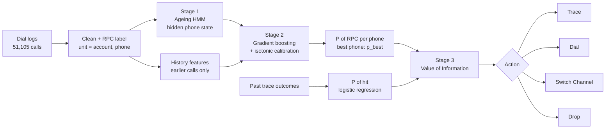

Open IIT Finalist
<div align="center">

# 📞 Skip-Trace Prioritisation with Ageing Hidden Markov Models

### Predicting *who will actually pick up*, and deciding when a paid skip-trace is worth its cost

[-E9A23B?style=for-the-badge)](#)
[](#)


**Team Data401** · Neal Kauntia · Krishna Keshav · IIT Kharagpur

</div>

---

## ✨ At a glance

| | |
|---|---|
| **Hit rate on held-out skip-traces** | 25.1% → **46.3%** (1.84×) |
| **Trace spend** | Rs. 25.3k → **Rs. 5.6k** (−77.8%) |
| **HMM state vs 250 verified phones** | **82.4%** agreement (206 / 250) |
| **RPC prediction, test AUC** | **0.701** (old priority rule: 0.536) |
| **Trace-hit model, held-out AUC** | **0.796** |
| **Output** | One action per account: **Dial · Switch Channel · Drop · Trace** |

> 🏁 **Competition:** Open IIT Data Analytics Competition (October 2026), problem set by CreditNirvana. Our team was one of the **top 10 finalists** invited to the final presentation round.

---

## 📑 Contents

1. [The problem](#-the-problem)
2. [Our approach](#-our-approach)
3. [Results](#-results)
4. [Key engineering decisions](#-key-engineering-decisions)
5. [Repository layout](#-repository-layout)
6. [How to run](#-how-to-run)
7. [Limitations and future work](#-limitations-and-future-work)
8. [Team](#-team)

---

## 🎯 The problem

In collections, a large share of calls go to numbers that are **dead**, **recycled to a stranger**, owned by a **relative**, or simply **being ignored**. Only **16.5%** of the 51,105 calls in our data (8,420) reached the borrower, a *right-party contact* (RPC).

Two kinds of failing phone look alike but need **opposite actions**:

| Looks like | Really is | Right response |
|---|---|---|
| Never answers | Borrower is **avoiding** us | Switch channel (WhatsApp, field visit) |
| Never answers | Number is **dead** | Skip-trace for a new number |
| Wrong-number replies | Number **recycled** to a stranger | Stop at once (the debt must never be disclosed) |

Skip-traces cost money (Rs. 104 on average here) and are usually triggered by a fixed rule such as *"after 15 failed calls"*. That fires **too late** for dead numbers and **wastes money** on balances too small to repay the trace.

**Task:** for each delinquent account, output a prioritised action (**Dial, Switch Channel, Drop, Trace**), and rank skip-traces by *expected financial gain*, not by attempt count.

---

## 🧠 Our approach



### Stage 1: Ageing Hidden Markov Model

We never see a phone's true health, only what happens when we call it. The HMM treats health as a hidden state and the call result as the visible symbol.

| Hidden state | Meaning | Typical call result |
|---|---|---|
| `REACH` | Works, borrower answers | RPC 24%, no answer 52% |
| `AVOID` | Works, borrower screens us | Rejected 40%, RPC 3% |
| `TEMP` | Temporarily unreachable | Not reachable 45% |
| `DEAD` | Switched off / invalid | Switched off 52% |
| `RECYC` | Given to a new subscriber | Wrong number 25% |
| `THIRD` | Relative / employer / reference | Third party 33% |

- **Ageing.** Calls are unevenly spaced (hours to 90 days apart), so after a gap of Δt days the belief is moved forward with the matrix exponential:

  $$P(\Delta t)=e^{Q\,\Delta t},\qquad b^-_t=b^+_{t-1}\,P(\Delta t)$$

  A "switched off" result from today points to `DEAD`. The same result from 90 days ago has mostly faded. Example rates: `DEAD → RECYC` 0.6% per day, `TEMP → REACH` 6% per day.
- **Learning from each call.** Bayes' rule updates the belief using the emission matrix $B$:
  $b^+_t(k)\propto b^-_t(k)\,B_{k,x_t}$.
- **"What-if" row.** To score a phone *today*, we add one virtual call that ages the belief but adds no evidence, so training and production use the same code.
- The belief vector and $P_{valid}=P(\text{REACH})+P(\text{AVOID})+P(\text{TEMP})$ are passed to Stage 2 as features.

### Stage 2: Calibrated gradient boosting

`HistGradientBoostingClassifier` predicts whether the next call is an RPC, using **24 features**:

| Group | Count | Examples |
|---|---|---|
| HMM beliefs | 7 | REACH, AVOID, TEMP, DEAD, RECYC, THIRD, P_valid |
| History (earlier calls only) | 9 | RPC rate, dead rate, rejected rate, failed-call streak, days since last RPC, **other-phone RPCs** |
| Static | 8 | owner type, number source, priority slot, portfolio, delinquency bucket, log overdue, channel, hour |

**Isotonic regression** (fitted on a separate validation split) turns raw scores into true probabilities, because the money calculation in Stage 3 needs real probabilities, not just a ranking.

> 💡 **Cross-phone avoidance signal.** `other_phone_rpcs` = account RPCs minus this phone's RPCs. If a borrower answers phone B but never phone A, phone A is probably not dead, it is being **screened**.

### Stage 3: Value of Information (VOI)

A trace is authorised only when the expected gain beats its cost:

$$\text{VOI}=P(\text{hit})\cdot\max(q_{new}-q_{now},\,0)\cdot\rho\cdot W\cdot\text{Balance}\;-\;C$$

| Term | Meaning | Value |
|---|---|---|
| $P(\text{hit})$ | Chance the trace finds a usable contact (logistic regression on 766 past traces) | per account |
| $q=1-(1-p)^{H}$ | Chance of reaching the borrower within $H=10$ calls | $q_{new}=0.901$ |
| $q_{now}$ | Same, using the account's best current phone | per account |
| $\rho$ | Extra share of the balance paid within 14 days after an RPC (estimated within-account, so borrower differences cancel) | 0.049 |
| $W$ | Number of such windows assumed to benefit | 2 |
| $C$ | Average trace cost in the data | Rs. 104 |

**Worked example** (same $P(\text{hit})=0.4$, same dead phone with $p_{best}=0.02$, so $q_{now}=0.183$):

| Balance | Expected gain | VOI | Decision |
|---|---|---|---|
| Rs. 1,00,000 | Rs. 2,813 | **+Rs. 2,709** | ✅ Trace |
| Rs. 3,000 | Rs. 84 | **−Rs. 20** | ❌ Block, drop |

### Final action rule (checked in this order)

1. **Trace** if VOI > 0
2. **Dial** if the best phone has $\hat p\ge 0.10$
3. **Switch Channel** if the phone is probably still the borrower's ($P_{valid}\ge 0.5$) but rarely answers
4. **Drop** otherwise

A separate **do-not-call list** holds numbers with $P(\text{RECYC})\ge 0.5$ or an earlier wrong-number reply, so a debt is not discussed with a stranger.

---

## 📊 Results

All numbers come from the **held-out test split**, which was touched once.

### 1. RPC prediction

<p align="center"></p>

| Model | Test AUC |
|---|---|
| Old priority-slot rule | 0.536 |
| Phone's own past RPC rate | 0.640 |
| Boosting without HMM features | 0.699 |
| **Boosting + Ageing HMM** | **0.701** |
| Same model, random-dialling calls only (n = 290, unbiased) | 0.675 |

Test PR-AUC is 0.291 and the Brier score is 0.135. Calibration is close to observed rates, with a mild tendency to under-predict on the test split (for example 0.147 predicted against 0.173 observed in one bin).

> The HMM adds only a little to AUC (0.699 → 0.701). Per-call AUC is capped, because even a healthy number answers only about one call in four, which is largely chance. The HMM's real value is the **interpretable state**, which drives the avoiding-versus-dead split, the recycled-number check, and the VOI rule.

### 2. Does the HMM understand phone health?

We compared HMM states with **250 independently verified phones** that the model was **never fitted to**.

<p align="center"></p>

| Verified state | Correct | Recall |
|---|---|---|
| Valid | 116 / 127 | 91.3% |
| Third party | 67 / 74 | 90.5% |
| Dead | 15 / 22 | 68.2% |
| Recycled | 8 / 27 | 29.6% |
| **Overall** | **206 / 250** | **82.4%** |

Recycled numbers are the hardest class, since they look like valid phones until a wrong-number reply appears. The do-not-call rule is therefore deliberately cautious.

### 3. Skip-trace value of information

On the **243 held-out traces**:

<p align="center"></p>

| Policy | Traces | Spend | Hits | Hit rate |
|---|---|---|---|---|
| Current rule: trace everything triggered | 243 | Rs. 25,268 | 61 | 25.1% |
| **Trace only if VOI > 0** | **54** | **Rs. 5,615** | **25** | **46.3%** |

The trace-hit logistic model reaches **AUC 0.796** on held-out traces. Its signs make sense: accounts whose phones still look valid (−0.42) or that reject many calls (−0.45) are **less** likely to give a hit.

### 4. Final queue for all 2,400 accounts

<p align="center"></p>

- **259** accounts are ranked by VOI in the skip-trace queue (the top one is worth about Rs. 5,781).
- **827** numbers are on the do-not-call list.

---

## 🛠 Key engineering decisions

| Pitfall we found | What we did |
|---|---|
| **Shared family phones.** Merging on `phone_id` alone silently multiplied rows across accounts | The unit of analysis is **(account_id, phone_id)**: 5,719 unique pairs |
| **24 "RPC" calls with no answer and zero talk time** | A call counts as RPC only if answered **and** talk time > 0 **and** an RPC disposition; those 24 are excluded |
| **Selection bias from the old dialler** | `agent_id`, dialling arm and selection propensity are **not** model inputs; a random-dialling check (AUC 0.675) confirms the model is not just learning the old policy |
| **Uneven time gaps and leakage** | Matrix-exponential ageing, plus a **no-peeking rule**: every feature for call *t* uses only calls 1 to *t − 1* |
| **Accounts leaking across splits** | Provided **account-level** train / validation / test split (35.8k / 7.9k / 7.4k calls); test used once |
| **Raw scores are not probabilities** | Isotonic calibration on a separate split |

---

## 📁 Repository layout

```
.
├── PS2_RPC_SkipTrace_Final.ipynb    # full pipeline: HMM → boosting → VOI → actions
├── report/
│   └── Data401_Report.pdf           # written report
├── docs/
│   └── Data401_Presentation.pptx    # finalist-round slides
├── assets/                          # figures used in this README
├── requirements.txt
├── data/                            # NOT included (see "Data")
└── outputs/                         # created when the notebook runs
    ├── calibration.png
    ├── account_actions.csv          # one action per account
    ├── skip_trace_queue.csv         # accounts ranked by VOI
    ├── do_not_call_list.csv         # compliance suppression list
    └── phone_scores.csv             # P(RPC) and state beliefs per phone
```

---

## 🚀 How to run

```bash
git clone https://github.com/124-CE/skip-trace-voi-ageing-hmm.git
cd skip-trace-voi-ageing-hmm

python -m venv .venv
source .venv/bin/activate          # Windows: .venv\Scripts\activate
pip install -r requirements.txt

jupyter lab
```

1. Put the six data files in a `data/` folder.
2. In the setup cell, set `DATA_DIR = Path("data")`.
3. Run all cells. The outputs are written to `outputs/`.

**Required files:** `dial_attempts.csv`, `phones.csv`, `accounts.csv`, `splits.csv`, `verified_contact_points.csv`, `skip_traces.csv`.

### 🔒 Data

The call logs and account data belong to the competition organisers (**CreditNirvana**) and are **not** included in this repository. The code expects the six files above, with the column names used in the notebook.

---

## ⚠️ Limitations and future work

- **HMM parameters are set by hand.** The emission and rate matrices come from domain knowledge and patterns in the data, not from the verified labels. Learning them with EM (Baum-Welch) is the obvious next step.
- **$\rho$ and $W$ are assumptions.** The VOI *ranking* depends on them, whereas the hit rates and the trace cost are observed.
- **The trace model learned only from accounts that were traced before.** Scores far outside that population are extrapolations.
- **Recycled numbers are weakly detected** (8 of 27). A dedicated wrong-number and shared-phone feature set would help.
- **Phones only.** Addresses and field visits (the second phase of the problem statement) are not modelled.
- **No live trial.** Results are from one split. A randomised exploration budget in production would keep low-scored numbers from being starved of evidence.

---

## 👥 Team

**Team Data401**, IIT Kharagpur

| | |
|---|---|
| **Krishna Keshav** | [GitHub](https://github.com/124-CE) · [LinkedIn](https://www.linkedin.com/in/krishna-keshav-53b654372/) |
| **Neal Kauntia** | <!-- add GitHub / LinkedIn link --> |

<div align="center">

*Built for the Open IIT Data Analytics Competition 2026 · Problem set by CreditNirvana*

</div>
